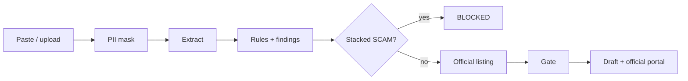

<p align="center">
  
</p>

<p align="center">
  <strong>Two-way recruitment trust for Kenya.</strong><br />
  Paste a job ad or applicant message. Get an evidence-backed verdict.<br />
  Apply only on the official portal. Never pay. Never WhatsApp-apply.
</p>

<p align="center">
  <a href="https://github.com/immaculate-munde/kazi-check/actions/workflows/build.yml"></a>
  
  
  
</p>

<p align="center">
  <a href="#quick-start">Quick start</a> ·
  <a href="#what-it-does">What it does</a> ·
  <a href="#verdicts">Verdicts</a> ·
  <a href="#run-locally">Run locally</a> ·
  <a href="#api">API</a> ·
  <a href="#whats-next">What's next</a>
</p>

---

## What it does

Kazi Check is **Verify. Match. Proceed.** — not a job board.

| Pillar | You do this | The app does this |
|--------|-------------|-------------------|
| **Verify** | Paste an advert, screenshot, PDF, or recruiter chat | Heuristic extract → point-table rules → stacked **SCAM** when earned → findings (flagged / passed / unknown) |
| **Match** | Drop a CV against a role | Skill gaps + a short domain quiz |
| **Proceed** | Confirm gaps, then apply | Job Bot opens the **official careers URL** with a cover draft. Blocked ads stay blocked |

Unknown is never a scam stamp. A missing org match is a **gap**, not a red flag.

### Job Bot

Upload a batch (paste, `.txt`, PDF, image, CSV). Raw files never hit disk. PII is masked. Each ad is gated:

| Gate | Meaning |
|------|---------|
| `BLOCKED` | SCAM or high risk — do not apply |
| `NEEDS_CONFIRMATION` | Gaps to confirm yourself first |
| `ELIGIBLE` | Draft + official portal / official email only |

There is **no** WhatsApp auto-send and **no** Playwright apply.



---

## Verdicts

Labels you will **never** see: `SAFE`, `legit`.

| Verdict | When |
|---------|------|
| **SCAM** | Stacked hits — fee + WhatsApp, lookalike + fee, government warning, or registry + fee |
| **High risk** | Score ≥ 60 without a stack |
| **Caution** | Score ≥ 30 |
| **Unsure** | Too little text, or nothing to judge |
| **No red flags found** | Current checks passed. Still confirm on the official careers page |

Every check also returns **findings**: flagged, passed, or unknown — so a clean Safaricom portal ad can say “no fee language detected,” not silence.

---

## Quick start

```bash
git clone https://github.com/immaculate-munde/kazi-check.git
cd kazi-check
npm install
cp .env.example .env
npm run dev
```

Open [http://localhost:3000](http://localhost:3000).

```bash
npm test          # vitest
npm run seed      # in-memory registry samples
```

Optional Postgres (Prisma is ready; the app still runs in-memory today):

```bash
docker compose up -d
# set DATABASE_URL in .env
npx prisma migrate dev
```

### Smoke the engine

```bash
curl -s http://localhost:3000/api/health

curl -s -X POST http://localhost:3000/api/checks \
  -H "Content-Type: application/json" \
  -d "{\"direction\":\"job_offer\",\"text\":\"Acme Roads Authority hiring 800 staff. Apply on WhatsApp. Send ID and Ksh 1,500 registration.\"}"
```

Expect **SCAM**. A clean Safaricom careers-portal ad should return **No red flags found**.

---

## App routes

| Route | Pillar |
|-------|--------|
| [`/check`](http://localhost:3000/check?direction=job_offer) · `/checks/[id]` | Verify a job offer or applicant |
| [`/bot`](http://localhost:3000/bot) | Job Bot inbox — upload, gate, official-portal apply |
| [`/skills`](http://localhost:3000/skills) · `/quiz` | Skill match + quiz |
| [`/offer`](http://localhost:3000/offer) | Offer-letter check + clarification email |
| [`/tracker`](http://localhost:3000/tracker) | Application safety tracker |
| [`/registry`](http://localhost:3000/registry) | Community flags **with reasons** |

---

## API

| Method | Path | Purpose |
|--------|------|---------|
| `GET` | `/api/health` | Health |
| `POST` | `/api/checks` | Extract → rules → verdict + **findings** |
| `GET` | `/api/checks/[id]` | Fetch a check |
| `POST` | `/api/checks/[id]/sms` | ThriveWave SMS (stub without keys) |
| `POST` | `/api/bot/upload` | Batch ads (paste / file). Nothing written to disk |
| `GET` | `/api/bot/queue` | Job Bot queue |
| `POST` | `/api/bot/apply` | Official portal / official email packet |
| `POST` | `/api/bot/digest` | SMS digest of a batch |
| `GET` | `/api/registry` | Subjects (`?direction=`) |
| `POST` | `/api/subjects/flags` | Community flag (fingerprint dedupe) |
| `POST` | `/api/webhooks/thrivewave/ussd` | USSD menu webhook |

---

## Stack

- **Next.js 16** (App Router) · TypeScript · Tailwind · Positivus-inspired brutalist UI
- Heuristic extract + deterministic **point table** (LLM/OCR must never pick the verdict)
- Text-rules for fees, M-Pesa/till, urgency, fake salary, PIN/OTP/ID
- Official listings index · OCR (tesseract.js / unpdf) · PII mask
- In-memory store now · Prisma schema ready for Postgres
- ThriveWave SMS/USSD **stubs** until HTTP is wired

---

## What's next

Stay on **this** repo. Next engine work is tracked in [#41](https://github.com/immaculate-munde/kazi-check/issues/41): organisation directory, registry statuses, persist scans, RDAP/MX, ThriveWave HTTP, then result UX.

Do **not**: switch to MySQL, store unmasked victim PII, scrape applications, or auto-submit via WhatsApp.

---

## Team

Issues and PRs are the source of truth — not this file for seat assignments.

| Open | What |
|------|------|
| [#40](https://github.com/immaculate-munde/kazi-check/pull/40) | Job Bot + gated SCAM — **merged** |
| [#43](https://github.com/immaculate-munde/kazi-check/pull/43) | Text-rules + flagged/passed/unknown findings |
| [#41](https://github.com/immaculate-munde/kazi-check/issues/41) | Steal-list from kazicheck — engine first, UI later |
